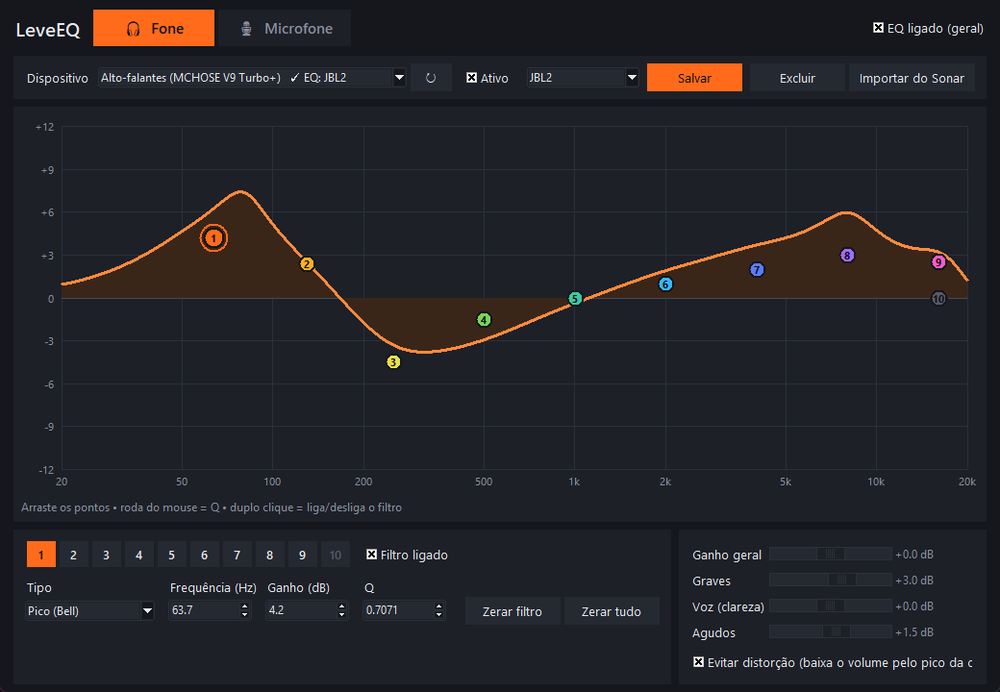
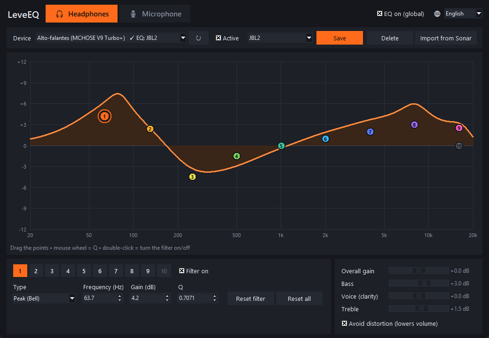

# LeveEQ

**Equalizador paramétrico leve para fone e microfone no Windows**
**Lightweight parametric equalizer for headphones and microphones on Windows**

[Português](#português) · [English](#english)



---

## Português

### O que é

O LeveEQ é um equalizador paramétrico para o seu fone e para o seu microfone,
com quantas bandas você quiser, com o mesmo estilo do equalizador do SteelSeries Sonar (dentro do
SteelSeries GG), só que muito mais leve.

Eu gostava muito do equalizador do Sonar, mas o GG inteiro pesava demais no meu PC.
Eu só queria o equalizador. Então criei o LeveEQ: uma janela simples, um ícone na
bandeja do Windows, e mais nada rodando em segundo plano.

### Uma nota sincera sobre o uso de IA

Quero ser transparente: **eu usei inteligência artificial (Claude, da Anthropic) para
criar este app.** Sei que o uso de IA na programação é mal visto por algumas pessoas,
e entendo e respeito essa opinião.

Eu só quis resolver um problema que eu tinha, e pensei que outras pessoas poderiam
querer essa mesma solução. Por isso estou compartilhando de graça e com o código
aberto, para que qualquer um possa ler, conferir que não tem nada escondido nem vírus,
e modificar como quiser.

Tenho o máximo respeito por todos os programadores e por quem estuda e trabalha duro
nessa área. Não quero ofender ninguém com este projeto. Se você encontrar algo que
possa ser melhorado, sugestões e correções são muito bem-vindas.

### Funcionalidades

- **Bandas paramétricas à vontade**: começa com 10 por dispositivo, e você pode
  adicionar até 50 ou remover as que não usa. Cada banda tem tipo, frequência,
  ganho e Q.
- **Tipos de filtro**: Pico (Bell), Shelf grave, Shelf agudo, Passa-alta,
  Passa-baixa, Notch, Passa-banda (0 dB e pico Q) e Passa-tudo.
- **Gráfico interativo**: arraste os pontos para mudar frequência e ganho, use a roda
  do mouse para mudar o Q e dê duplo clique para ligar ou desligar o filtro. Duplo
  clique num lugar vazio cria uma banda nova ali, e o botão direito num ponto remove
  a banda.
- **Fone e microfone** em abas separadas.
- **Um EQ por dispositivo**: cada fone ou microfone guarda o próprio ajuste, e todos
  funcionam ao mesmo tempo. Se você trocar o fone de entrada (por exemplo, do headset
  para a interface de áudio), o EQ certo já está lá.
- **Graves, Voz (clareza) e Agudos**, além do ganho geral.
- **Proteção contra distorção** (opcional): baixa o volume pelo pico real da curva.
- **Presets**: salvar, carregar e excluir.
- **Importar do SteelSeries Sonar**: se você tem o GG instalado, o LeveEQ lê os seus
  presets direto do banco de dados local do Sonar, incluindo os de fábrica, com
  busca por nome.
- **Ícone na bandeja** perto do relógio: abrir, ligar ou desligar o EQ e sair.
  Fechar a janela só esconde o app.
- **Mudanças aplicadas na hora**, enquanto você arrasta os pontos.
- **Português e inglês**: troque o idioma no seletor 🌐 no canto superior direito. Na
  primeira vez, o app usa o idioma do Windows.

### Como funciona

O LeveEQ **não processa o áudio sozinho**. O Windows não deixa um app comum mexer no
som de outros programas. Para isso é preciso um componente de áudio do sistema (um
"APO"). O LeveEQ usa o **[Equalizer APO](https://sourceforge.net/projects/equalizerapo/)**,
um motor de equalização gratuito, de código aberto e muito leve, que já é usado há
anos por muita gente.

```
 [ LeveEQ ]  --grava-->  leveeq.txt  --lido por-->  [ Equalizer APO ]  -->  seu fone / mic
 (interface)            (configuração)              (motor de áudio do Windows)
```

1. Você ajusta os filtros no LeveEQ.
2. O LeveEQ grava os filtros em `C:\Program Files\EqualizerAPO\config\leveeq.txt`,
   com um bloco para cada dispositivo (`Device: {id-do-dispositivo}`).
3. O Equalizer APO percebe a mudança e recarrega a configuração na hora. Ele aplica
   os filtros dentro do próprio processo de áudio do Windows, quase sem usar CPU.
4. Quando a janela está fechada, o LeveEQ fica só com o ícone na bandeja. O som
   continua sendo processado pelo Equalizer APO.

**Os filtros:** cada filtro é um biquad calculado pelas fórmulas do
[Audio EQ Cookbook](https://www.w3.org/TR/audio-eq-cookbook/) (Robert Bristow-Johnson),
que é o padrão da indústria e o mesmo tipo de filtro do Sonar. O Equalizer APO usa
essas mesmas fórmulas. O gráfico do LeveEQ é calculado do mesmo jeito, então **a curva
na tela é o que você ouve**. Eu conferi isso passando os filtros pelo próprio motor do
Equalizer APO (com o `Benchmark.exe` que vem com ele), com diferença menor que 0,2 dB.

**Proteção contra distorção:** quando você aumenta frequências, o som pode passar do
limite e distorcer. O Sonar tem um limitador para isso, mas o Equalizer APO não tem.
Com a opção "Evitar distorção" ligada, o LeveEQ calcula o pico da curva inteira e
abaixa o volume geral na mesma medida. Desligada, o volume fica igual ao do Sonar,
mas pode distorcer em músicas ou jogos muito altos.

**Importação do Sonar:** o LeveEQ faz uma cópia do arquivo
`C:\ProgramData\SteelSeries\GG\apps\sonar\db\database.db` (o banco de dados local do
Sonar) e lê os presets dessa cópia. Ele nunca altera nada do GG.

### Instalação

1. Baixe este repositório: botão verde **Code > Download ZIP**.
2. **Extraia o ZIP inteiro** numa pasta.
3. Dê dois cliques em **`Instalar-LeveEQ.bat`**. Você não precisa instalar nada
   manualmente. O que o instalador faz sozinho:
   - procura o Python 3.8+ e, se não encontrar, oferece instalar pelo `winget` ou
     abre o site do Python;
   - instala as bibliotecas `pystray` e `pillow`;
   - copia o LeveEQ para `%LOCALAPPDATA%\Programs\LeveEQ` (não precisa de
     administrador);
   - cria os atalhos na Área de Trabalho e no menu Iniciar e, se você quiser, para
     abrir junto com o Windows;
   - verifica se o Equalizer APO está instalado e, se não estiver, abre a página
     de download.
4. **Instale o Equalizer APO** (se ainda não tiver). No **Configurator** dele, marque
   o seu fone (em *Playback devices*) e o seu microfone (em *Capture devices*).
   Depois **reinicie o PC**.
5. Abra o LeveEQ pelo atalho, escolha o dispositivo em cada aba e ajuste o EQ.

> **Usa o SteelSeries GG/Sonar?** Desligue o Sonar ou feche o GG. Não marque os
> dispositivos "SteelSeries Sonar - ..." no Equalizer APO: marque o seu fone e o seu
> microfone de verdade. No Windows, escolha esses mesmos dispositivos como saída e
> entrada padrão.

### Desinstalação

Rode o **`Desinstalar-LeveEQ.bat`** (ele também fica na pasta do programa). Ele:

- fecha o app;
- devolve a configuração original do Equalizer APO;
- remove os atalhos e a pasta do programa;
- pergunta se você também quer apagar os seus presets.

O Equalizer APO continua instalado. Se quiser removê-lo, desinstale pelo Windows.

### Transparência: o que o LeveEQ toca no seu PC

| Onde | O quê |
|---|---|
| `%LOCALAPPDATA%\Programs\LeveEQ\` | O programa (`leveeq.pyw`), o ícone e o desinstalador |
| `%APPDATA%\LeveEQ\` | Seus ajustes (`estado.json`) e presets (`presets.json`) |
| `C:\Program Files\EqualizerAPO\config\leveeq.txt` | Os filtros gerados para o Equalizer APO |
| `C:\Program Files\EqualizerAPO\config\config.txt` | Passa a ter só `Include: leveeq.txt`. O original é guardado como `config.txt.antes-leveeq` |
| Área de Trabalho / menu Iniciar / Inicializar | Atalhos `LeveEQ.lnk` |
| Banco do Sonar (se existir) | **Só leitura**, a partir de uma cópia temporária |

O app **não acessa a internet**, não coleta dados e não precisa de administrador. Só
o instalador usa a internet, para baixar as bibliotecas Python pelo `pip` e para abrir
as páginas de download. O código inteiro está em um único arquivo, o `leveeq.pyw`,
comentado em português. Os textos da interface ficam todos juntos no início do arquivo
(`STRINGS`), então dá para adicionar um novo idioma facilmente.

### Diferenças para o Sonar

- **Não tem** redução de ruído por IA, noise gate, compressor, surround virtual nem
  ChatMix. São justamente as partes que deixam o Sonar pesado.
- **Graves, Voz e Agudos** são aproximações (filtros de pico em 80 Hz, 2 kHz e 8 kHz).
- No lugar do limitador do Sonar existe a opção "Evitar distorção" (veja acima).

### Problemas comuns

- **O som não muda:** confira se o dispositivo foi marcado no Configurator do
  Equalizer APO e se você reiniciou o PC depois. Confira também se é esse o
  dispositivo selecionado no LeveEQ e no Windows.
- **"Equalizer APO não encontrado":** instale o Equalizer APO e reabra o LeveEQ.
- **O ícone não aparece perto do relógio:** clique na setinha `^` da barra de tarefas
  e arraste o ícone para fora dela.
- **O Configurator dá erro de "Qt platform plugin":** abra ele pelo menu Iniciar
  (*Equalizer APO > Configurator*).

### Rodar a partir do código

```
pip install -r requirements.txt
pythonw leveeq.pyw
```

### Licença

[MIT](LICENSE): use, copie, modifique e distribua como quiser.

O LeveEQ é um projeto independente e **não tem nenhuma ligação com a SteelSeries**.
SteelSeries, GG e Sonar são marcas da SteelSeries ApS. O Equalizer APO é um projeto
separado, de seus próprios autores.

---

## English

### What it is



LeveEQ ("leve" means "light" in Portuguese) is a parametric equalizer for your
headphones and your microphone, with as many bands as you want. It works in the style of the SteelSeries Sonar
equalizer (part of SteelSeries GG), but it is much lighter.

I really liked Sonar's equalizer, but the whole GG suite was too heavy for my PC, and
the equalizer was all I needed. So I made LeveEQ: a simple window, a tray icon, and
nothing else running in the background.

### An honest note about AI

I want to be transparent: **I used artificial intelligence (Claude, by Anthropic) to
build this app.** I know some people see AI-assisted programming in a bad light, and
I understand and respect that.

I only wanted to solve a problem I had, and I thought other people might want the same
solution. That is why I'm sharing it for free and as open source, so anyone can read
it, check that nothing is hidden and that there is no malware, and change it however
they like.

I have the utmost respect for all programmers and for everyone who studies and works
hard in this field. I don't want to offend anyone with this project. If you find
something that could be better, suggestions and fixes are very welcome.

### Features

- **As many parametric bands as you want**: each device starts with 10, and you
  can add up to 50 or remove the ones you don't use. Each band has a type,
  frequency, gain and Q.
- **Filter types**: Peak (Bell), Low shelf, High shelf, High-pass, Low-pass, Notch,
  Band-pass (0 dB and Q peak) and All-pass.
- **Interactive graph**: drag the points to change frequency and gain, use the mouse
  wheel to change Q, and double-click a point to turn its filter on or off.
  Double-click empty space to add a band there, and right-click a point to
  remove it.
- **Headphones and microphone** in separate tabs.
- **One EQ per device**: each headset or microphone keeps its own settings, and all of
  them work at the same time. If you move your headphones to another output (for
  example, from the headset jack to an audio interface), the right EQ is already
  there.
- **Bass, Voice (clarity) and Treble**, plus overall gain.
- **Distortion protection** (optional): lowers the volume by the real peak of the
  curve.
- **Presets**: save, load and delete.
- **Import from SteelSeries Sonar**: if you have GG installed, LeveEQ reads your
  presets straight from Sonar's local database, factory presets included, with
  search by name.
- **Tray icon** next to the clock: open, turn the EQ on or off, and quit. Closing the
  window only hides the app.
- **Changes apply instantly**, even while you drag the points.
- **Portuguese and English**: switch the language with the 🌐 selector in the top-right
  corner. On first launch, the app follows your Windows language.

### How it works

LeveEQ **does not process audio by itself**. Windows does not let a regular app
change the sound of other programs; that needs a system audio component (an "APO").
LeveEQ uses **[Equalizer APO](https://sourceforge.net/projects/equalizerapo/)**, a
free, open source and very light equalization engine that many people have used for
years.

```
 [ LeveEQ ]  --writes-->  leveeq.txt  --read by-->  [ Equalizer APO ]  -->  your headset / mic
 (interface)             (config file)              (Windows audio engine)
```

1. You adjust the filters in LeveEQ.
2. LeveEQ writes them to `C:\Program Files\EqualizerAPO\config\leveeq.txt`, with one
   block per device (`Device: {device-id}`).
3. Equalizer APO notices the change and reloads the config right away. It applies the
   filters inside the Windows audio process, with almost no CPU use.
4. When the window is closed, LeveEQ is just a tray icon. Your sound keeps being
   processed by Equalizer APO.

**The filters:** each filter is a biquad computed with the
[Audio EQ Cookbook](https://www.w3.org/TR/audio-eq-cookbook/) formulas (Robert
Bristow-Johnson). This is the industry standard and the same kind of filter Sonar
uses. Equalizer APO uses these same formulas, and LeveEQ draws its graph the same way,
so **the curve on screen is what you hear**. I checked this by running the filters
through Equalizer APO's own engine (with the `Benchmark.exe` it ships with), with less
than 0.2 dB of difference.

**Distortion protection:** boosting frequencies can push the sound past the limit and
make it distort. Sonar has a limiter for this, but Equalizer APO does not. With
"Evitar distorção" (avoid distortion) on, LeveEQ finds the peak of the whole curve and
lowers the overall volume by that amount. With it off, the volume matches Sonar, but
very loud music or games may distort.

**Sonar import:** LeveEQ makes a copy of
`C:\ProgramData\SteelSeries\GG\apps\sonar\db\database.db` (Sonar's local database)
and reads the presets from that copy. It never changes anything in GG.

### Installation

1. Download this repository: green **Code > Download ZIP** button.
2. **Extract the whole ZIP** to a folder.
3. Double-click **`Instalar-LeveEQ.bat`**. You don't need to install anything by
   hand. Here is what the installer does for you:
   - looks for Python 3.8+ and, if it is missing, offers to install it with `winget`
     or opens the Python website;
   - installs the `pystray` and `pillow` libraries;
   - copies LeveEQ to `%LOCALAPPDATA%\Programs\LeveEQ` (no administrator needed);
   - creates Desktop and Start menu shortcuts and, if you want, one to start with
     Windows;
   - checks whether Equalizer APO is installed and, if not, opens its download page.
4. **Install Equalizer APO** (if you don't have it yet). In its **Configurator**,
   select your headphones (under *Playback devices*) and your microphone (under
   *Capture devices*). Then **restart your PC**.
5. Open LeveEQ from the shortcut, pick the device in each tab, and adjust the EQ.

> **Using SteelSeries GG/Sonar?** Turn Sonar off or close GG. Don't select the
> "SteelSeries Sonar - ..." devices in Equalizer APO: select your real headphones and
> microphone. In Windows, set those same devices as the default output and input.

### Uninstalling

Run **`Desinstalar-LeveEQ.bat`** (a copy is also in the program folder). It:

- closes the app;
- restores your original Equalizer APO config;
- removes the shortcuts and the program folder;
- asks whether you also want to delete your presets.

Equalizer APO stays installed. If you want to remove it, uninstall it from Windows.

### Transparency: what LeveEQ touches on your PC

| Where | What |
|---|---|
| `%LOCALAPPDATA%\Programs\LeveEQ\` | The program (`leveeq.pyw`), icon and uninstaller |
| `%APPDATA%\LeveEQ\` | Your settings (`estado.json`) and presets (`presets.json`) |
| `C:\Program Files\EqualizerAPO\config\leveeq.txt` | The filters generated for Equalizer APO |
| `C:\Program Files\EqualizerAPO\config\config.txt` | Changed to just `Include: leveeq.txt`. The original is kept as `config.txt.antes-leveeq` |
| Desktop / Start menu / Startup | `LeveEQ.lnk` shortcuts |
| Sonar database (if present) | **Read only**, from a temporary copy |

The app **does not access the internet**, collects no data and needs no administrator
rights. Only the installer goes online, to download the Python libraries with `pip`
and to open download pages. All of the code is in one file, `leveeq.pyw`, with
comments in Portuguese. All interface texts are together at the top of the file
(`STRINGS`), so adding a new language is easy: copy the `"en"` block and translate it.

### Differences from Sonar

- **No** AI noise reduction, noise gate, compressor, virtual surround or ChatMix.
  Those are exactly the parts that make Sonar heavy.
- **Bass, Voice and Treble** are approximations (peak filters at 80 Hz, 2 kHz and
  8 kHz).
- Instead of Sonar's limiter, there is the "avoid distortion" option (see above).

### Troubleshooting

- **The sound doesn't change:** check that the device is selected in Equalizer APO's
  Configurator and that you restarted your PC afterwards. Also check that the same
  device is selected in LeveEQ and in Windows.
- **"Equalizer APO não encontrado" (not found):** install Equalizer APO and reopen
  LeveEQ.
- **No icon next to the clock:** click the `^` arrow on the taskbar and drag the icon
  out of it.
- **The Configurator shows a "Qt platform plugin" error:** open it from the Start
  menu (*Equalizer APO > Configurator*).

### Running from source

```
pip install -r requirements.txt
pythonw leveeq.pyw
```

### License

[MIT](LICENSE): use, copy, modify and share it however you like.

LeveEQ is an independent project and is **not affiliated with SteelSeries** in any
way. SteelSeries, GG and Sonar are trademarks of SteelSeries ApS. Equalizer APO is a
separate project by its own authors.
